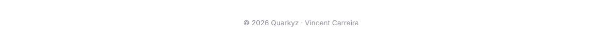

  Salut, moi c'est <b>Vincent</b>, alias <b>Quarkyz</b> 👋 
  Développeur web indépendant et étudiant en <b>administration systèmes & réseaux</b>. 
  Je dessine l'interface, j'écris le code <b>et</b> je gère l'infrastructure qui le fait tourner.

  
  

 

## ✦ Hébergement dès 0,50 € par mois

  Un petit budget ne devrait pas t'empêcher d'avoir un site propre. 
  Stockage SSD, accès SFTP, sauvegardes et espace client inclus.

<table>
  <tr>
    <td width="200" align="center"><h3>0,50 €</h3><b>Site HTML</b> 500 Mo de stockage</td>
    <td width="200" align="center"><h3>0,59 €</h3><b>Base MariaDB</b> Base dédiée</td>
    <td width="200" align="center"><h3>0,89 €</h3><b>Pack Démarrage</b> Plusieurs services réunis</td>
    <td width="200" align="center"><h3>0,99 €</h3><b>Bot Discord</b> Node.js, 24h/24</td>
  </tr>
</table>

Prix par mois. Détails et commande sur <a href="https://quarkyz.com/hebergement/">quarkyz.com/hebergement</a>.

  

## ✦ Ce que je réalise

<table>
  <tr>
    <td width="300" valign="top">
      <h3>🌐 Sites vitrines</h3>
      Une présence en ligne claire, rapide et adaptée au mobile.
    </td>
    <td width="300" valign="top">
      <h3>🛒 E-commerce</h3>
      Une boutique pour vendre, avec un catalogue pensé pour vos clients.
    </td>
  </tr>
  <tr>
    <td width="300" valign="top">
      <h3>⚙️ Applications web</h3>
      Espaces clients, tableaux de bord et outils métier sur mesure.
    </td>
    <td width="300" valign="top">
      <h3>🎨 Design UI/UX</h3>
      Maquettes, interfaces, logos et identité visuelle.
    </td>
  </tr>
  <tr>
    <td width="300" valign="top">
      <h3>🖥️ <a href="https://quarkyz.com/hebergement/">Hébergement</a></h3>
      Sites HTML, Node.js, bots Discord et bases de données.
    </td>
    <td width="300" valign="top">
      <h3>🛡️ Infra & réseau</h3>
      Serveurs Linux, réseaux, sécurité et automatisation.
    </td>
  </tr>
</table>

 

## ✦ Développement

  

## ✦ Systèmes, réseaux & infrastructure

  

  
  
  
  
  
  
  
  
   
  
  
  
  
  
  
  

 

## ✦ Projets phares

<table>
  <tr>
    <td width="300" valign="top">
      <h3>💻 <a href="https://quarkyz.com/projets/luxbytech/">Luxbytech</a></h3>
      <code>Site web + tableau de bord</code>
      
Réparation, vente et configuration de PC, consoles et smartphones.

    </td>
    <td width="300" valign="top">
      <h3>🥖 <a href="https://quarkyz.com/projets/atelier-du-pain/">L'Atelier du Pain</a></h3>
      <code>Logo & identité</code>
      
Identité visuelle d'une boulangerie fictive, inspirée de l'artisanat et de l'authenticité.

    </td>
  </tr>
  <tr>
    <td width="300" valign="top">
      <h3>🎓 <a href="https://quarkyz.com/projets/arisbde/">Aris BDE</a></h3>
      <code>Site + dashboard + espace compte</code>
      
Une communauté étudiante, des événements, des rencontres et des souvenirs à créer.

    </td>
    <td width="300" valign="top">
      <h3>🧪 <a href="https://quarkyz.com/projets/">Projets en cours</a></h3>
      <code>Toujours en construction</code>
      
Découvre toutes mes réalisations et ce que je prépare en ce moment.

    </td>
  </tr>
</table>

 

## ✦ Me contacter

  
  
  
  

