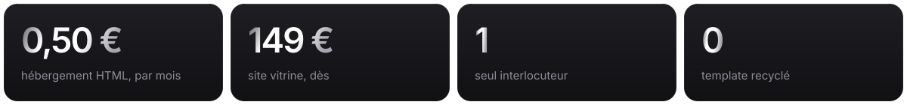
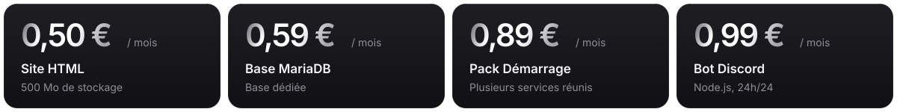
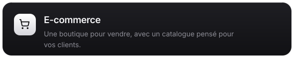
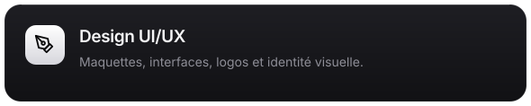
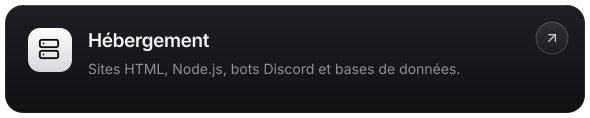
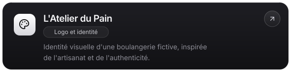
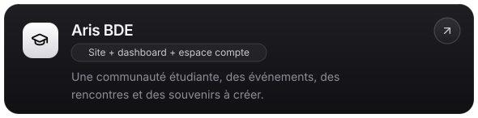

  Salut, moi c'est <b>Vincent</b>, alias <b>Quarkyz</b> 👋 
  Développeur web indépendant et étudiant en <b>administration systèmes & réseaux</b>. 
  Je dessine l'interface, j'écris le code <b>et</b> je gère l'infrastructure qui le fait tourner.

  
  

 

## ✦ Hébergement dès 0,50 € par mois

  Un petit budget ne devrait pas t'empêcher d'avoir un site propre. 
  Stockage SSD, accès SFTP, sauvegardes et espace client inclus.

Prix par mois. Détails et commande sur <a href="https://quarkyz.com/hebergement/">quarkyz.com/hebergement</a>.

  

## ✦ Ce que je réalise

  
  
  
  
  
  

 

## ✦ Développement

  

## ✦ Systèmes, réseaux & infrastructure

  

  
  
  
  
  
  
  
  
   
  
  
  
  
  
  
  

 

## ✦ Projets phares

  
  
  
  

 

## ✦ Me contacter

  
  
  
  

